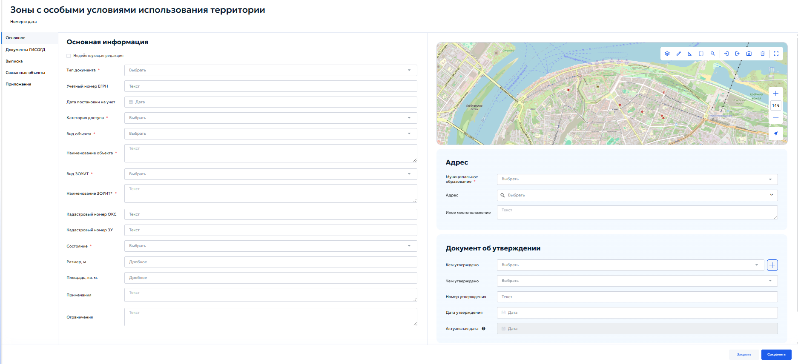
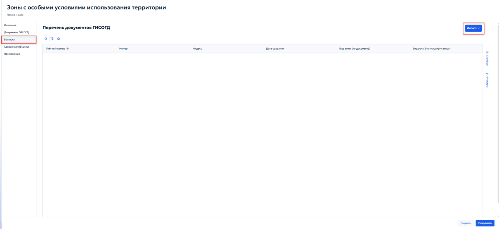

# 5.4.10 ЗОУИТ

Расшифровка сокращения [ЗОУИТ](../../introduction.md#term-zouit) приведена в перечне терминов и сокращений.

Раздел предназначен для учета сведений об установлении, изменении и прекращении существования зон с особыми условиями использования территории (ЗОУИТ). В раздел вносятся документы, на основании которых такие зоны создаются или ликвидируются, и информация об их характеристиках.

Зоны с особыми условиями использования территории устанавливаются для защиты:

1. «объектов природного происхождения» — леса, водные объекты, источники питьевого водоснабжения;

2. «искусственных объектов» — промышленные предприятия, линии электропередачи, трубопроводы, объекты культурного наследия.

В зависимости от назначения зоны подразделяются на:

1. «охранные» — зоны вокруг линий электропередачи, магистральных трубопроводов, железных дорог и т. п.;

2. «санитарно-защитные» — отделяющие жилую застройку от производственных объектов;

3. «водоохранные и рыбоохранные» — примыкающие к водным объектам;

4. зоны охраны объектов культурного наследия;

5. иные виды, предусмотренные статьей 105 Земельного кодекса РФ и классификатором, утвержденным приказом Минстроя России от 06.08.2020 № 443.

Каждая зона утверждается решением, постановлением, приказом или иным документом уполномоченного органа власти. Ограничения использования земельных участков в границах зоны определяются отраслевыми нормативными актами.

При открытии раздела отображается табличная форма со списком записей. Работа с реестром выполняется в соответствии с общими принципами, описанными в разделе [4.2 — Работа с табличными формами](../../operations/navigation-and-tables.md#42) настоящего Руководства (рисунок 102).

<figure class="doc-figure" markdown="span">
  
  <figcaption>Рисунок 102 — Раздел 10. Реестр «Зоны с особыми условиями использования территории».</figcaption>
</figure>

Добавление новой записи или редактирование существующей осуществляется в карточке, содержащей вкладки: «Основное», «Документы ГИСОГД», «Выписка», «Связанные объекты», «Приложения».

В блоке «Основная информация» указать следующие данные:

1. «Недействующая редакция» — установить флажок, если документ или зона утратили силу. Порядок работы с недействующей редакцией приведён в пункте [5.4.9 — Искусственные земельные участки](section-9.md#549);

2. «Тип документа» — выбрать из выпадающего списка тип документа ГИСОГД;

3. «Учетный номер ЕГРН» — ввести учетный номер зоны в Едином государственном реестре недвижимости;

4. «Дата постановки на учет» — указать с помощью календаря дату внесения сведений о зоне в ЕГРН;

5. «Категория доступа» — выбрать из выпадающего списка категорию доступа;

6. «Вид объекта» — выбрать из выпадающего списка вид объекта, образующего зону;

7. «Наименование объекта» — указать наименование объекта, в отношении которого установлена зона;

8. «Вид ЗОУИТ» — выбрать из выпадающего списка классификатор вида зон с условиями использования территории;

9. «Наименование ЗОУИТ» — указать полное наименование зоны;

10. «Кадастровый номер ОКС» — указать кадастровый номер объекта капитального строительства;

11. «Кадастровый номер ЗУ» — указать кадастровый номер земельного участка;

12. «Состояние» — выбрать из выпадающего списка состояние зоны;

13. «Размер, м» — указать размер зоны в метрах;

14. «Площадь, кв. м» — указать площадь зоны в квадратных метрах;

15. «Примечания» — при необходимости ввести примечание по объекту;

16. «Ограничения» — при необходимости указать ограничения использования земельного участка и объектов капитального строительства в границах зоны.

В блоке «Адрес» указать следующие данные:

1. «Муниципальное образование» — выбрать из списка нужный городской округ или муниципальный район, к которому относится ЗОУИТ;

2. «Адрес» — нажать кнопку «Выбрать». В открывшемся окне указать адрес зоны. Порядок работы с окном приведён в пункте [5.4.8 — Выбор адреса](section-8.md#address-selection) настоящего Руководства;

3. «Иное использование» — описать местоположение зоны и ориентиры, связанные с ней.

В блоке «Документ об утверждении» содержатся реквизиты правового акта или иного документа, на основании которого внесена запись:

1. «Кем утверждено» — выбрать из выпадающего списка орган власти или организацию, принявшую документ. При нажатии кнопки { .ui-icon } откроется окно с реквизитами лиц;

2. «Чем утверждено» — выбрать из выпадающего списка документ, которым утверждена зона.

Границы зоны отображаются на карте в правой части карточки. Для загрузки координат из файла использовать кнопку «Импорт» на панели инструментов карты; порядок импорта описан в пункте [4.5.2.12 — Импорт геометрии](../../operations/map.md#45212). При наличии кадастровой выписки учитывать порядок осей в системе координат. После заполнения всех полей нажать кнопку «Сохранить».

Во вкладке «Документы ГИСОГД» приложить документы к записи о зоне. Порядок работы с вкладкой приведён в пункте [5.3.2 — Размещение документа во вкладке «Документы ГИСОГД»](../document-placement.md#532).

Во вкладке «Связанные объекты» установить связи между записью ЗОУИТ и объектами других разделов ГИСОГД. Общие правила работы со связанными реестрами описаны в пункте [4.3 — Управление записями в реестре](../../operations/records.md#43), порядок установления связей — в пункте [5.4.7.3 — Связанные объекты](section-7.md#5473).

Во вкладке «Приложения» при необходимости приложить дополнительные файлы для ЗОУИТ.

## 5.4.10.1 Вкладка «Выписка»

Вкладка предназначена для учёта и хранения выписок из реестра ЗОУИТ. Здесь отображается список созданных выписок (рисунок 103).

<figure class="doc-figure" markdown="span">
  
  <figcaption>Рисунок 103 — Вкладка «Выписка».</figcaption>
</figure>

Кнопки панели инструментов позволяют добавить или отредактировать запись о выписке. Кнопка «Импорт» загружает выписку в формате XML.
