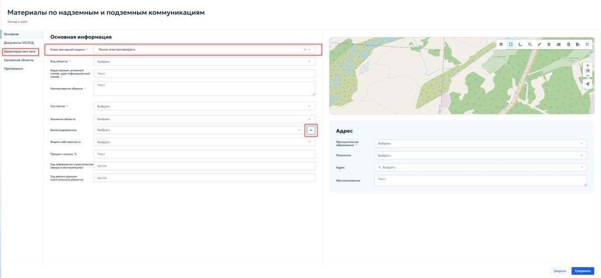
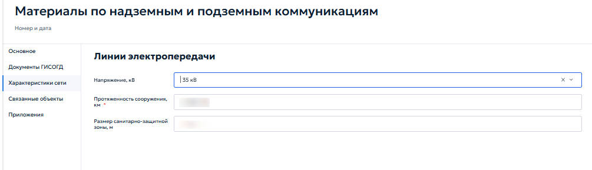

# 5.4.11 Надземные и подземные коммуникации

Раздел предназначен для ведения реестра сведений, документов и материалов, содержащих информацию о местоположении и характеристиках существующих и проектируемых сетей инженерно-технического обеспечения, электрических сетей и сетей связи. Ведение раздела осуществляется в соответствии с пунктом 14 части 4 статьи 56 Градостроительного кодекса Российской Федерации и постановлением Правительства Российской Федерации от 13.03.2020 № 279.

Для записей раздела предусмотрено установление связей с объектами других разделов ГИСОГД:

1. делами о земельных участках;

2. документацией по планировке территории;

3. инженерными изысканиями;

4. зонами с особыми условиями использования территории.

При открытии раздела отображается табличная форма, работа с которой описана в пункте [4.2 «Работа с табличными формами»](../../operations/navigation-and-tables.md#42). Карточка содержит вкладки «Основное», «Документы ГИСОГД», «Характеристики сети», «Связанные объекты» и «Приложения» (рисунок 104).

<figure class="doc-figure" markdown="span">
  
  <figcaption>Рисунок 104 — Карточка «Материалы по надземным и подземным коммуникациям».</figcaption>
</figure>

Вкладка «Основное» предназначена для ввода общей информации о коммуникации. В блоке «Основная информация» указать следующие данные:

1. «Класс векторной модели» — выбрать из выпадающего списка доступные значения, соответствующие типам инженерных сетей. После выбора значения в левой части карточки появляется вкладка «Характеристики сети»;

2. «Вид объекта» — выбрать из справочника вид линейного объекта;

3. «Кадастровый, условный номер, идентификационный номер» — указать номер объекта недвижимости;

4. «Наименование объекта» — указать наименование коммуникации;

5. «Состояние» — выбрать из выпадающего списка текущую стадию существования сети;

6. «Значение объекта» — выбрать категорию значения объекта из выпадающего списка;

7. «Балансодержатель» — выбрать из справочника организацию, ответственную за баланс коммуникации. Кнопка { .ui-icon } позволяет добавить новую организацию. Подробнее добавление новой организации описано в пункте [5.2.1 «Выдача разрешения на строительство»](../requests.md#521) настоящего Руководства;

8. «Форма собственности» — выбрать форму собственности из выпадающего списка;

9. «Процент износа, %» — указать процент износа сети;

10. «Год завершения строительства (ввода в эксплуатацию)» — указать год завершения строительства и ввода в эксплуатацию проекта;

11. «Год реконструкции (капитального ремонта)» — указать год последней реконструкции или капитального ремонта.

В блоке «Адрес» указать следующие данные:

1. «Муниципальное образование» — выбрать из справочника нужный городской округ или муниципальный район, где находится коммуникация;

2. «Поселение» — выбрать из справочника поселение, где находится коммуникация;

3. «Адрес» — указать с помощью кнопки «Выбрать» адрес местоположения коммуникации. Выбор адреса описан в пункте [5.4.8 «Выбор адреса»](section-8.md#address-selection) настоящего Руководства;

4. «Местоположение» — ввести дополнительное описание местоположения коммуникации.

Границы коммуникации отображаются на карте в правой части карточки. Для загрузки точных координат из файла использовать кнопку «Импорт» на панели инструментов карты. Порядок импорта описан в пункте [4.5.2.12 «Импорт геометрии»](../../operations/map.md#45212).

Во вкладке «Документы ГИСОГД» приложить документы о коммуникации. Порядок работы с вкладкой приведён в пунктах [5.3.2 «Размещение документа во вкладке «Документы ГИСОГД»](../document-placement.md#532) и [5.3.3 «Связывание документа ГИСОГД с заявкой на размещение»](../document-placement.md#533).

Во вкладке «Связанные объекты» установить связи между записью о коммуникации и объектами других разделов ГИСОГД. Работа со связанными реестрами осуществляется в соответствии с пунктом [4.3 «Управление записями в реестре»](../../operations/records.md#43). Порядок установления связей описан в разделе [5.4.7.3 «Связанные объекты»](section-7.md#5473).

Во вкладке «Приложения» приложить файлы, не отнесенные к категории документов ГИСОГД. Порядок работы с вкладкой приведён в пункте [4.5.1 «Приложенные файлы»](../../operations/records.md#451).

## 5.4.11.1 Вкладка «Характеристики сети»

Вкладка предназначена для ввода технических параметров выбранного типа инженерной сети. Данные используются при формировании выписок, аналитической обработке, определении границ охранных зон и расчёте нагрузок (рисунок 105).

<figure class="doc-figure" markdown="span">
  
  <figcaption>Рисунок 105 — Вкладка «Характеристики сети».</figcaption>
</figure>

Состав полей динамически изменяется в зависимости от выбранного класса. Для класса «Линии электропередачи» отображаются следующие поля:

1. «Напряжение, кВ» — выбрать номинальное напряжение линии из выпадающего списка;

2. «Протяженность сооружения, км» — указать дробное число для указания общей длины сети в километрах;

3. «Размер санитарно-защитной зоны, м» — указать дробное число для указания размера санитарно-защитной зоны в метрах.

Для других классов перечень полей будет отличаться в соответствии с нормативными требованиями к описанию объектов соответствующего типа.
