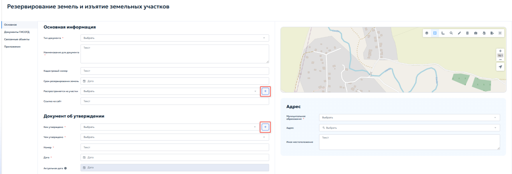

# 5.4.12 Резервирование земель и изъятие земельных участков

Раздел предназначен для ведения реестра решений о резервировании земель и решений об изъятии участков для государственных или муниципальных нужд. Ведение раздела осуществляется в соответствии с пунктом 15 части 4 статьи 56 Градостроительного кодекса Российской Федерации и постановлением Правительства Российской Федерации от 13.03.2020 № 279.

В реестр включаются правовые акты, на основании которых:

1. определенные территории резервируются для будущего строительства объектов государственного или муниципального значения — дороги, инженерные сети, социальные объекты;

2. земельные участки изымаются у правообладателей для реализации таких проектов.

Каждая запись реестра содержит сведения о виде документа, реквизиты утвердившего акта, при наличии кадастровый номер, сведения о территории, а также графическую информацию о границах резервируемого или изымаемого участка на карте.

Для записей раздела предусмотрено установление связей с делами о земельных участках для ведения истории каждого участка.

При открытии раздела отображается табличная форма, работа с которой описана в пункте [4.2 — Работа с табличными формами](../../operations/navigation-and-tables.md#42). Карточка содержит вкладки «Основное», «Документы ГИСОГД», «Связанные объекты» и «Приложения» (рисунок 106).

<figure class="doc-figure" markdown="span">
  
  <figcaption>Рисунок 106 — Карточка «Резервирование земель и изъятие земельных участков».</figcaption>
</figure>

Вкладка «Основное» предназначена для ввода общих сведений о документе и характеристиках земельного участка. В блоке «Основная информация» указываются следующие данные:

1. «Тип документа» — выбрать из выпадающего списка соответствующее решение о земельном участке;

2. «Наименование документа» — указать наименование документа;

3. «Кадастровый номер» — указать кадастровый номер земельного участка;

4. «Срок резервирования земель» — указать срок окончания резервирования земель с помощью календаря;

5. «Распространяется на участки» — выбрать из выпадающего списка способ образования или распределения на участке. При нажатии кнопки { .ui-icon } открывается окно выбора записей из реестра «Дела о земельных участках». Выбранные участки будут отображаться в списке, а сам документ окажется связанным с их историей;

6. «Ссылка на сайт» — указать ссылку на страницу публикации документа в сети Интернет.

В блоке «Документ об утверждении» указываются реквизиты правового акта: кем и чем утверждено, номер и дата издания документа, по аналогии с другими пунктами (см. пункт [5.4.3.2 — Заполнение вкладки «Основное»](section-3.md#5432)). При нажатии кнопки { .ui-icon } открывается окно для ввода реквизитов лица. Подробное описание работы с формой добавления реквизитов приведено в пункте [5.2.1 — Реквизиты заявителя](../requests.md#applicant-details) настоящего Руководства.

Блок «Адрес» заполняется аналогично пунктам [5.4.8 — Выбор адреса](section-8.md#address-selection) и [5.4.10 — ЗОУИТ](section-10.md#5410).

Границы резервируемого или изымаемого земельного участка отображаются и редактируются на карте. Для точного ввода координат использовать кнопку «Импорт» на панели инструментов карты; порядок импорта приведён в пункте [4.5.2.12 — Импорт геометрии](../../operations/map.md#45212). Ручная отрисовка не рекомендуется, если в дальнейшем потребуются официальные координаты.

Во вкладке «Документы ГИСОГД» прикрепляются документы о резервировании или изъятии земельного участка, графические материалы и сопроводительные документы. Порядок работы с вкладкой приведён в пунктах [5.3.2 — Размещение документа во вкладке «Документы ГИСОГД»](../document-placement.md#532) и [5.3.3 — Связывание документа ГИСОГД с заявкой на размещение](../document-placement.md#533).

Во вкладке «Связанные объекты» устанавливаются связи записи о резервировании или изъятии земельного участка с объектами других разделов ГИСОГД. Работа со связанными реестрами осуществляется в соответствии с общими правилами, описанными в пункте [4.3 — Управление записями в реестре](../../operations/records.md#43). Порядок установления связей аналогичен описанному в разделе [5.4.7.3 — Связанные объекты](section-7.md#5473).

Вкладка «Приложения» предназначена для хранения дополнительных файлов, не относящихся к документам ГИСОГД: сопроводительной переписки, копий уведомлений и обзорных схем. Порядок работы с вкладкой приведён в пункте [4.5.1 — Приложенные файлы](../../operations/records.md#451).
