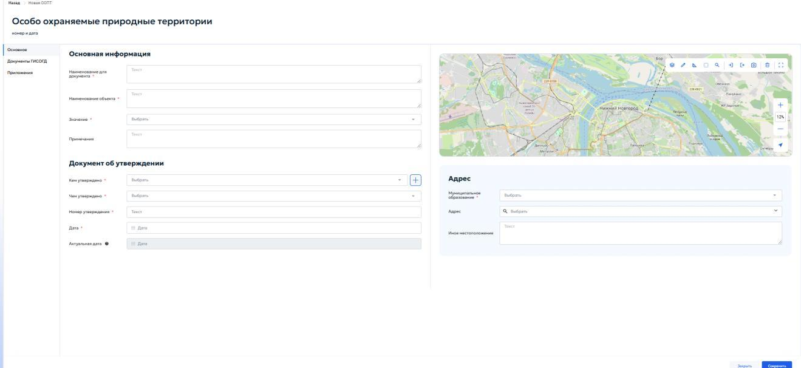
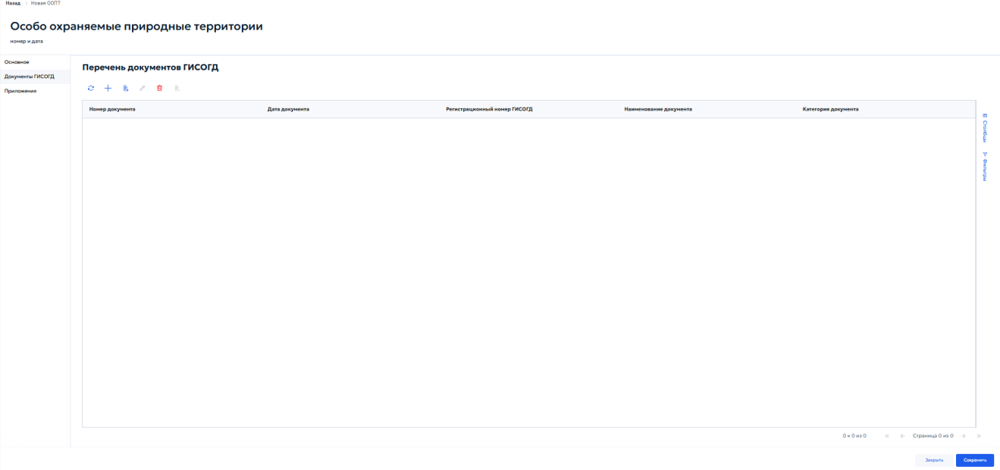
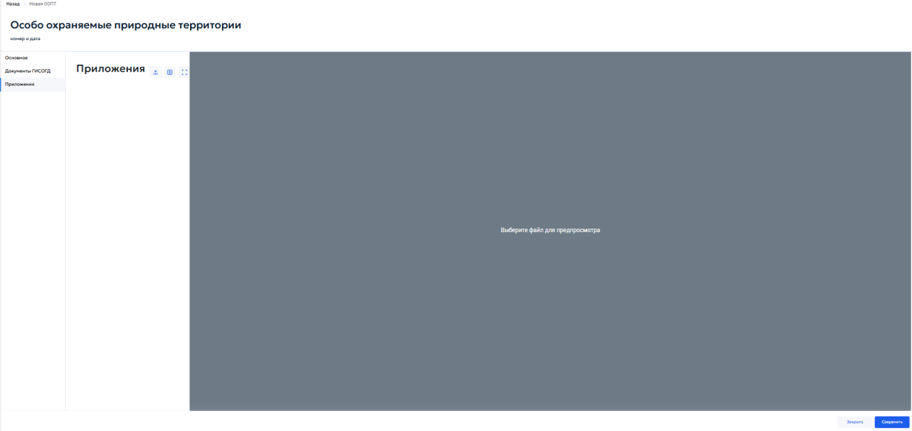

# 5.4.15 Особо охраняемые природные территории

Раздел «Особо охраняемые природные территории» предназначен для учета сведений, документов и материалов об особо охраняемых природных территориях, а также нормативных правовых актов, которыми утверждены положения об особо охраняемых природных территориях или внесены изменения в такие положения.

В реестре хранятся основные сведения об особо охраняемой природной территории, реквизиты документа об утверждении, адресная и пространственная привязка, связанные документы ГИСОГД и приложения.

Для добавления новой записи нажать кнопку «Добавить» на панели инструментов реестра. Откроется карточка «Особо охраняемые природные территории» во вкладке «Основное» (рисунок 147).

<figure class="doc-figure" markdown="span">
  
  <figcaption>Рисунок 147 — Карточка «Особо охраняемые природные территории». Вкладка «Основное».</figcaption>
</figure>

Карточка содержит следующие вкладки:

- «Основное»;

- «Документы ГИСОГД»;

- «Приложения».

Во вкладке «Основное» отображаются блоки «Основная информация», «Документ об утверждении» и «Адрес», а также карта для пространственной привязки особо охраняемой природной территории.

В блоке «Основная информация» указываются основные сведения об особо охраняемой природной территории.

В состав блока «Основная информация» входят следующие поля:

1. «Наименование для документа» — ввести наименование, которое должно использоваться при формировании и отображении документа. Поле обязательно для заполнения;

2. «Наименование объекта» — ввести полное наименование особо охраняемой природной территории. Поле обязательно для заполнения;

3. «Значение» — выбрать требуемое значение из выпадающего списка в соответствии со сведениями об особо охраняемой природной территории. Поле обязательно для заполнения;

4. «Примечания» — при необходимости внести дополнительные сведения об объекте, особенностях его учета или источнике данных.

В блоке «Документ об утверждении» указываются реквизиты документа, которым утверждена особо охраняемая природная территория или положение о ней.

В состав блока «Документ об утверждении» входят следующие поля:

1. «Кем утверждено» — выбрать орган, организацию, юридическое или физическое лицо, утвердившее документ. Если нужная запись отсутствует, нажать кнопку «+» справа от поля. Откроется окно «Реквизиты ЮЛ/ФЛ/ИП/ОИВ». Порядок работы с ним описан в пункте [5.2.1 «Реквизиты заявителя»](../requests.md#applicant-details). Поле обязательно для заполнения;

2. «Чем утверждено» — выбрать вид документа об утверждении из выпадающего списка. Поле обязательно для заполнения;

3. «Номер утверждения» — ввести номер документа об утверждении. Поле обязательно для заполнения;

4. «Дата» — указать дату документа об утверждении с помощью календаря. Поле обязательно для заполнения;

5. «Актуальная дата» — поле отображает актуальную дату сведений. Поле недоступно для ручного редактирования и заполняется системой.

Блок «Адрес» предназначен для указания территориальной и адресной привязки особо охраняемой природной территории.

В состав блока «Адрес» входят следующие поля:

1. «Муниципальное образование» — выбрать муниципальное образование из выпадающего списка. Поле обязательно для заполнения;

2. «Адрес» — выбрать адрес из адресного справочника. Для поиска начать вводить адрес и выбрать подходящую запись из выпадающего списка;

3. «Иное местоположение» — указать местоположение вручную, если адрес отсутствует в справочнике или требуется дополнительное описание территории.

В правой части вкладки «Основное» отображается карта. Инструменты карты предназначены для указания, просмотра и изменения границы особо охраняемой природной территории, а также проверки ее пространственного положения.

Для нанесения границы использовать инструменты рисования геометрии. Порядок добавления и удаления геометрии описан в пункте [4.5.2.10 «Добавление и удаление геометрии»](../../operations/map.md#45210) настоящего Руководства. При наличии файла с координатами граница загружается с помощью импорта геометрии, описанного в пункте [4.5.2.12 «Импорт геометрии»](../../operations/map.md#45212) настоящего Руководства.

После заполнения обязательных полей и указания пространственной привязки нажать кнопку «Сохранить». Для выхода из карточки без сохранения нажать кнопку «Закрыть».

Во вкладке «Документы ГИСОГД» отображается перечень документов ГИСОГД, связанных с особо охраняемой природной территорией (рисунок 148).

<figure class="doc-figure" markdown="span">
  
  <figcaption>Рисунок 148 — Вкладка «Документы ГИСОГД» в карточке особо охраняемой природной территории.</figcaption>
</figure>

Перечень представлен в табличной форме и содержит следующие столбцы:

1. «Номер документа» — номер связанного документа;

2. «Дата документа» — дата связанного документа;

3. «Регистрационный номер ГИСОГД» — регистрационный номер документа в ГИСОГД;

4. «Наименование документа» — наименование связанного документа;

5. «Категория документа» — категория документа ГИСОГД.

На панели инструментов доступны стандартные действия для обновления перечня, добавления и управления связанными документами. Справа расположены панели «Столбцы» и «Фильтры», предназначенные для настройки отображения и отбора записей.

Порядок создания и заполнения карточки документа ГИСОГД приведен в пункте [5.3.2 «Размещение документа во вкладке «Документы ГИСОГД»](../document-placement.md#532), а порядок связывания документа с заявкой на размещение — в пункте [5.3.3 «Связывание документа ГИСОГД с заявкой на размещение»](../document-placement.md#533) настоящего Руководства.

Во вкладке «Приложения» прикрепляются файлы, относящиеся к особо охраняемой природной территории и не размещаемые как самостоятельные документы ГИСОГД (рисунок 149).

<figure class="doc-figure" markdown="span">
  
  <figcaption>Рисунок 149 — Вкладка «Приложения» в карточке особо охраняемой природной территории.</figcaption>
</figure>

В левой части вкладки отображается список прикрепленных файлов, в правой части — область предварительного просмотра выбранного файла. Для загрузки приложения нажать кнопку загрузки, выбрать файл на компьютере и после загрузки проверить его отображение в области предварительного просмотра.

Подробный порядок работы с файлами приведен в пункте [4.5.1 «Приложенные файлы»](../../operations/records.md#451) настоящего Руководства.

После добавления документов и приложений нажать кнопку «Сохранить» для сохранения внесенных изменений.
