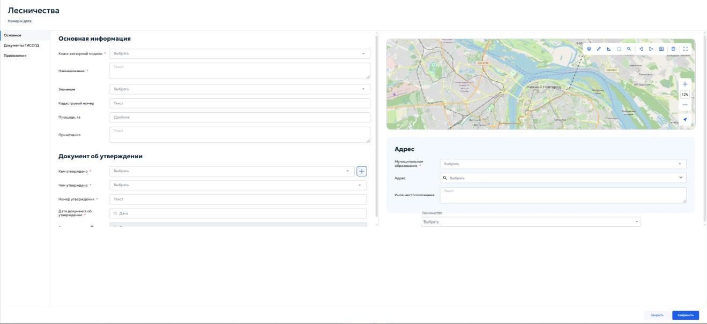

# 5.4.16 Лесничества

Раздел «Лесничества» предназначен для учета сведений, документов и материалов о лесничествах, в том числе лесохозяйственных регламентов, проектов освоения лесов и проектной документации лесных участков.

В реестре хранятся основные сведения о лесничестве, реквизиты документа об утверждении, адресная и пространственная привязка, связанные документы ГИСОГД и приложения.

Для добавления новой записи нажать кнопку «Добавить» на панели инструментов реестра. Откроется карточка «Лесничества» во вкладке «Основное» (рисунок 150).

<figure class="doc-figure" markdown="span">
  
  <figcaption>Рисунок 150 — Карточка «Лесничества». Вкладка «Основное».</figcaption>
</figure>

В верхней части карточки отображается строка «Номер и дата» с системными сведениями о записи. Значения формируются системой после сохранения карточки и не вводятся пользователем вручную.

Карточка содержит следующие вкладки:

- «Основное»;

- «Документы ГИСОГД»;

- «Приложения».

Во вкладке «Основное» отображаются блоки «Основная информация», «Документ об утверждении» и «Адрес», поле «Лесничество», а также карта для пространственной привязки объекта.

В блоке «Основная информация» указываются основные сведения о лесничестве.

В состав блока «Основная информация» входят следующие поля:

1. «Класс векторной модели» — выбрать требуемый класс векторной модели из выпадающего списка. Поле обязательно для заполнения;

2. «Наименование» — ввести полное наименование лесничества в соответствии с документом-основанием. Поле обязательно для заполнения;

3. «Значение» — выбрать требуемое значение из выпадающего списка в соответствии со сведениями о лесничестве;

4. «Кадастровый номер» — при наличии ввести кадастровый номер лесного участка или иного учитываемого объекта;

5. «Площадь, га» — указать площадь объекта в гектарах. Поле предназначено для ввода дробного числового значения;

6. «Примечания» — при необходимости внести дополнительные сведения об объекте, особенностях его учета или источнике данных.

В блоке «Документ об утверждении» указываются реквизиты документа, которым утверждены сведения о лесничестве или соответствующий документ лесного планирования.

В состав блока «Документ об утверждении» входят следующие поля:

1. «Кем утверждено» — выбрать орган, организацию, юридическое или физическое лицо, утвердившее документ. Если нужная запись отсутствует, нажать кнопку «+» справа от поля. Откроется окно «Реквизиты ЮЛ/ФЛ/ИП/ОИВ». Порядок работы с ним описан в пункте [5.2.1 «Реквизиты заявителя»](../requests.md#applicant-details). Поле обязательно для заполнения;

2. «Чем утверждено» — выбрать вид документа об утверждении из выпадающего списка. Поле обязательно для заполнения;

3. «Номер утверждения» — ввести номер документа об утверждении. Поле обязательно для заполнения;

4. «Дата документа об утверждении» — указать дату документа с помощью календаря. Поле обязательно для заполнения;

5. «Актуальная дата» — поле отображает актуальную дату сведений. Поле недоступно для ручного редактирования и заполняется системой.

Блок «Адрес» предназначен для указания территориальной и адресной привязки лесничества.

В состав блока «Адрес» входят следующие поля:

1. «Муниципальное образование» — выбрать муниципальное образование из выпадающего списка. Поле обязательно для заполнения;

2. «Адрес» — выбрать адрес из адресного справочника. Для поиска начать вводить адрес и выбрать подходящую запись из выпадающего списка;

3. «Иное местоположение» — указать местоположение вручную, если адрес отсутствует в справочнике или требуется дополнительное описание территории.

В поле «Лесничество» выбрать соответствующее лесничество из выпадающего списка.

В правой части вкладки «Основное» отображается карта. Инструменты карты предназначены для указания, просмотра и изменения границы лесничества или лесного участка, а также проверки его пространственного положения.

Для нанесения границы использовать инструменты рисования геометрии. Порядок добавления и удаления геометрии описан в пункте [4.5.2.10 «Добавление и удаление геометрии»](../../operations/map.md#45210) настоящего Руководства. При наличии файла с координатами граница загружается с помощью импорта геометрии, описанного в пункте [4.5.2.12 «Импорт геометрии»](../../operations/map.md#45212) настоящего Руководства.

После заполнения обязательных полей и указания пространственной привязки нажать кнопку «Сохранить». Для выхода из карточки без сохранения нажать кнопку «Закрыть».

Во вкладке «Документы ГИСОГД» добавляются документы, относящиеся к лесничеству, в том числе лесохозяйственные регламенты, проекты освоения лесов и проектная документация лесных участков. Порядок создания и заполнения карточки документа ГИСОГД приведен в пункте [5.3.2 «Размещение документа во вкладке «Документы ГИСОГД»](../document-placement.md#532) настоящего Руководства.

Во вкладке «Приложения» прикрепляются файлы, относящиеся к лесничеству и не размещаемые как самостоятельные документы ГИСОГД. Подробный порядок работы с файлами приведен в пункте [4.5.1 «Приложенные файлы»](../../operations/records.md#451) настоящего Руководства.

После добавления документов и приложений нажать кнопку «Сохранить» для сохранения внесенных изменений.
