# 5.4.3 Документы территориального планирования муниципальных образований

В раздел «Документы территориального планирования муниципальных образований» вносятся генеральные планы городских и муниципальных округов, а также схемы территориального планирования муниципальных районов (рисунок 60).

<figure class="doc-figure" markdown="span">
  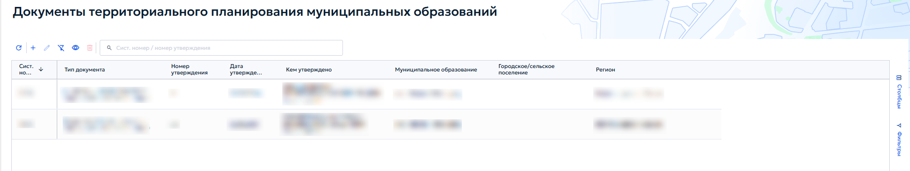
  <figcaption>Рисунок 60 — Раздел 3. Реестр «Документы территориального планирования муниципальных образований».</figcaption>
</figure>

Документы территориального планирования федерального, межрегионального, регионального и муниципального уровней включают в себя текстовую и графическую часть и определяют направления развития территории соответствующего уровня. Например, региональная схема территориального планирования (РСТП) показывает расположение объектов регионального значения, дорожной и инженерной инфраструктуры, их характеристики. Планируемые объекты наносятся на карту, а сами документы заносятся в реестр ГИСОГД.

Ниже приведен порядок внесения документа территориального планирования на примере генерального плана городского округа.

## 5.4.3.1 Создание записи

Для создания записи выполнить следующие действия:

1. на панели инструментов реестра нажать кнопку «Добавить»;

2. в открывшейся карточке заполнить атрибуты (рисунок 61).

<figure class="doc-figure" markdown="span">
  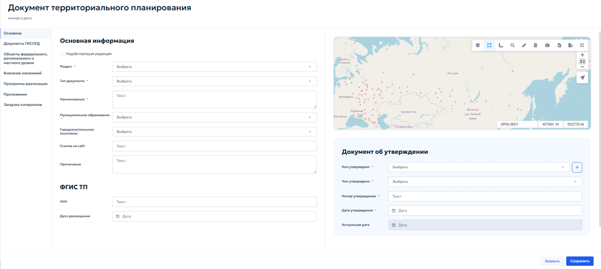
  <figcaption>Рисунок 61 — Заполнение сведений по документу территориального планирования.</figcaption>
</figure>

## 5.4.3.2 Заполнение вкладки «Основное»

Во вкладке «Основное» в блоке «Основная информация» выбрать следующие данные:

1. «Раздел» — выбрать значение «Документы территориального планирования муниципальных образований»;

2. «Тип документа» — выбрать «Генеральный план городского округа, муниципального округа»;

3. «Наименование» — ввести полное наименование в соответствии с утвержденным документом;

4. «Муниципальное образование» — выбрать из списка нужный городской округ или муниципальный район;

5. «Городское/сельское поселение» — при необходимости выбрать поселение;

6. «Ссылка на сайт» — указать адрес страницы муниципалитета, на которой размещен документ;

7. «Примечания» — внести дополнительные сведения, например об изменениях документа.

В блоке «Документ об утверждении» указать:

1. «Кем утверждено» — выбрать из выпадающего списка орган или должностное лицо, утвердившее документ;

2. «Чем утверждено» — выбрать вид нормативного правового акта: «Указ», «Распоряжение», «Решение», «Постановление» или «Приказ»;

3. «Номер утверждения» — ввести номер документа;

4. «Дату утверждения» — указать дату акта с помощью календаря;

5. «Актуальная дата» — поле заполняется автоматически на основании даты последнего документа ГИСОГД о внесении изменений. Ручное редактирование не требуется.

Нанесение границ выполняется вручную средствами рисования геометрии на карте или путем импорта геометрии из файла. Порядок рисования геометрии описан в разделе [4.5.2.10 — Добавление и удаление геометрии](../../operations/map.md#45210). Общий вид карточки документа территориального планирования приведен на рисунке 62.

<figure class="doc-figure" markdown="span">
  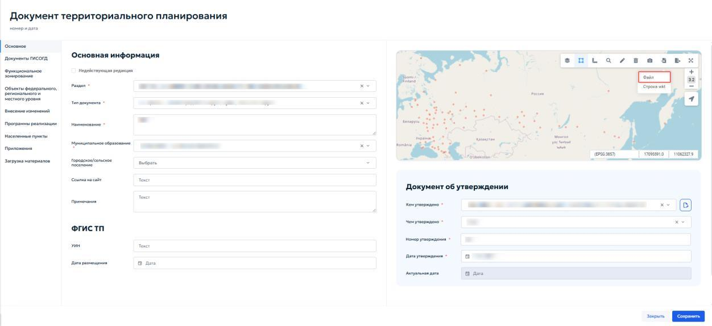
  <figcaption>Рисунок 62 — Документ территориального планирования.</figcaption>
</figure>

На карте нажать кнопку «Импорт» и выбрать пункт меню «Файл» (рисунок 63).

<figure class="doc-figure" markdown="span">
  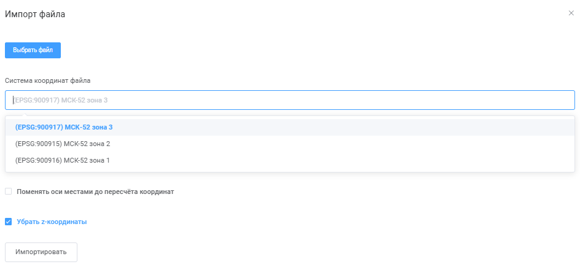
  <figcaption>Рисунок 63 — Импорт геометрии из файла.</figcaption>
</figure>

В окне импорта выбрать файл с координатами — обычно используется формат MIF. В поле «Система координат» ввести «МСК». Система предложит доступные варианты местных систем координат (рисунок 64).

<figure class="doc-figure" markdown="span">
  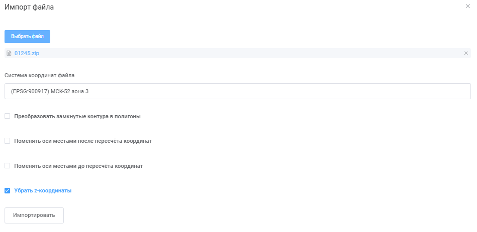
  <figcaption>Рисунок 64 — Выбор зоны МСК.</figcaption>
</figure>

По координатам из файла определить нужную зону: если координата X начинается с 1 миллиона, это первая зона (МСК-1, МСК-2 и т. д.). Выбрать соответствующую систему координат (рисунок 65).

<figure class="doc-figure" markdown="span">
  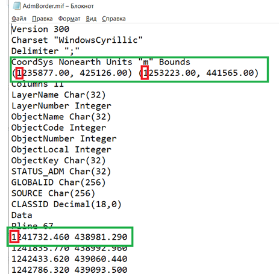
  <figcaption>Рисунок 65 — Определение зоны.</figcaption>
</figure>

Для загрузки координат и границ загруженных объектов нажать кнопку «Импортировать».

## 5.4.3.3 Добавление документов ГИСОГД

Во вкладке «Документы ГИСОГД» внести материалы генерального плана или схемы территориального планирования, а также правовые документы об утверждении или внесении изменений (рисунок 66).

<figure class="doc-figure" markdown="span">
  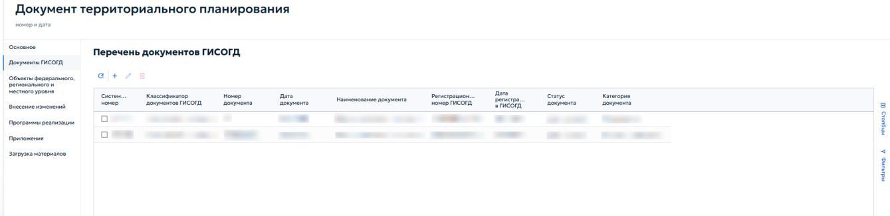
  <figcaption>Рисунок 66 — Перечень документов ГИСОГД для документа территориального планирования.</figcaption>
</figure>

Для добавления документа ГИСОГД нажать кнопку { .ui-icon } на панели инструментов. В карточке необходимо заполнить реквизиты документа ГИСОГД и приложить файлы для документа.

Во вкладке «Приложенные файлы» в генеральном плане прикрепляются текстовая часть генерального плана, схемы и правовой документ об утверждении или о внесении изменений в генеральный план (рисунок 67). При наличии документов о публичных слушаниях они также прикрепляются во вкладке «Приложенные файлы».

<figure class="doc-figure" markdown="span">
  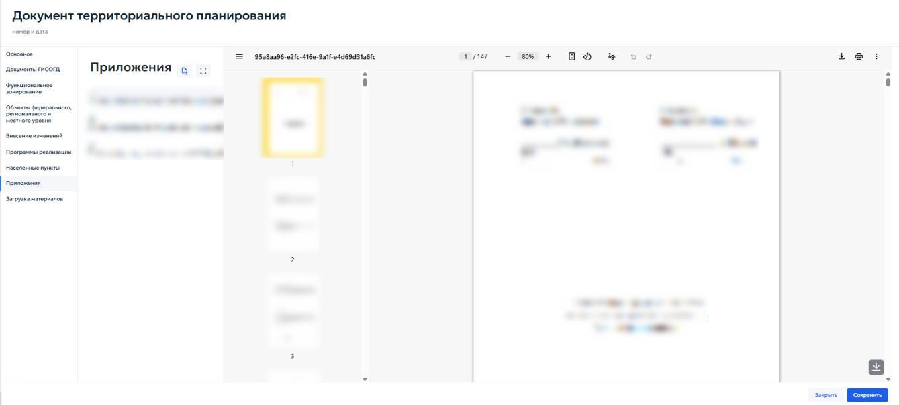
  <figcaption>Рисунок 67 — Приложенные к документу ГИСОГД «Генеральный план» файлы.</figcaption>
</figure>

Вкладка «Функциональное зонирование» в карточке генерального плана позволяет внести перечень функциональных зон, включенных в схему функционального зонирования генерального плана (рисунок 68).

<figure class="doc-figure" markdown="span">
  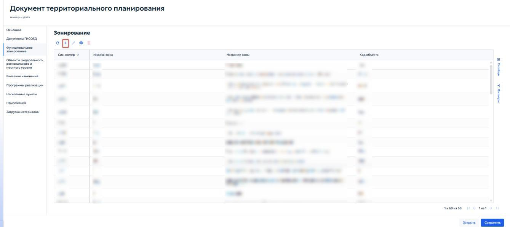
  <figcaption>Рисунок 68 — Список функциональных зон в генплане.</figcaption>
</figure>

Открывшаяся карточка функциональной зоны включает в себя информационный блок «Информация об объекте», в составе которого находятся следующие поля:

1. «Код объекта» — уникальный код контура; допускается совпадение с кодом функциональной зоны;

2. «Индекс зоны» — указать краткое буквенно-цифровое обозначение зоны;

3. «Название зоны» — ввести полное наименование функциональной зоны в соответствии с генеральным планом;

4. «Название по CLASSID» — при необходимости указать текстовую характеристику зоны.

Если зона является архивной, установить флажок «Архивная зона» в начале блока.

Карточка «Функциональная зона» показана на рисунке 69.

<figure class="doc-figure" markdown="span">
  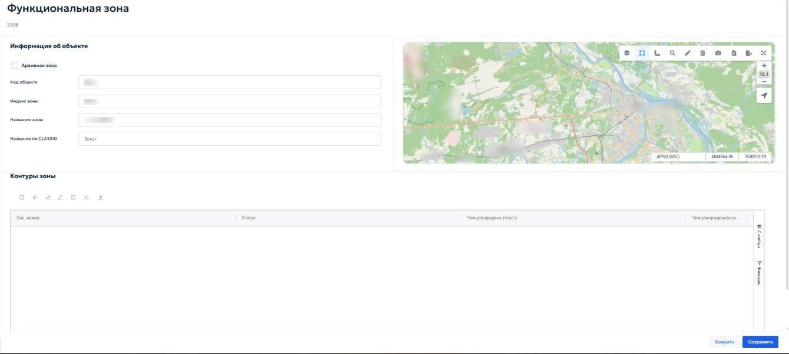
  <figcaption>Рисунок 69 — Карточка добавления типа зоны генерального плана.</figcaption>
</figure>

Блок «Контуры зоны» содержит таблицу, в которой перечислены все пространственные контуры данной функциональной зоны (рисунок 70). Таблица включает следующие столбцы:

1. «Системный номер» — системный номер контура;

2. «Статус» — состояние контура;

3. «Чем утверждено (текст)» — краткое описание документа-основания;

4. «Чем утверждено (ссылка)» — ссылка на документ ГИСОГД, которым утвержден контур (рисунок 70).

<figure class="doc-figure" markdown="span">
  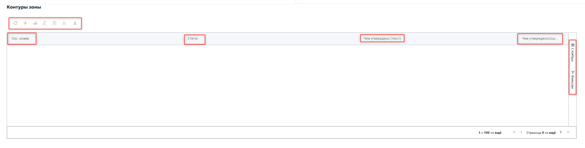
  <figcaption>Рисунок 70 — Контуры зоны.</figcaption>
</figure>

Панель инструментов блока позволяет редактировать, загружать и удалить действующий контур. При нажатии на кнопку { .ui-icon } открывается карточка «Контуры функциональных зон». Она предназначена для добавления или редактирования пространственного контура. Общий вид карточки приведен на рисунке 71.

<figure class="doc-figure" markdown="span">
  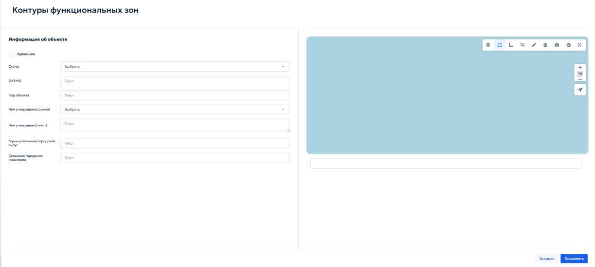
  <figcaption>Рисунок 71 — Контуры функциональных зон.</figcaption>
</figure>

Внутри карточки находится информационный блок «Информация об объекте», который состоит из следующих элементов:

1. «Архивное» — флажок, который устанавливается, если контур утратил актуальность;

2. «Статус» — выбрать значение из выпадающего списка: «существующий» — действующий контур или «планируемый» — контур, который планируется к установке в будущем;

3. «ОКТМО» — код муниципального образования;

4. «Код объекта» — уникальный код контура;

5. «Чем утверждено (ссылка)» — выбрать из выпадающего списка документ ГИСОГД, которым утвержден данный контур. В списке отображаются реквизиты документов — номер, дата, дата регистрации, извещающая организация. Для выбора щелкнуть левой кнопкой мыши по нужной строке;

6. «Чем утверждено» — указать, каким документом утверждена новая функциональная зона;

7. «Муниципальный/городской округ» — выбрать из списка муниципальное образование, на территории которого расположен контур;

8. «Сельское/городское поселение» — при необходимости выбрать поселение из списка.

Код объекта для функциональной зоны генплана введен Приказом Министерства экономического развития РФ от 9 января 2018 г. № 10 «Об утверждении Требований к описанию и отображению в документах территориального планирования объектов федерального значения, объектов регионального значения, объектов местного значения и о признании утратившим силу приказа Минэкономразвития России от 7 декабря 2016 г. № 793». Генеральные планы, разработанные до даты приказа, кодов объекта не имеют.

## 5.4.3.4 Загрузка материалов

Отличия этой операции от импорта геометрии на карте приведены в справке [«Импорт геометрии и загрузка материалов»](../../reference/import.md).

Загрузка материалов выполняется во вкладке «Загрузка материалов» карточки документа территориального планирования. Вкладка содержит блок «Загрузка пространственных данных».

Вкладка предназначена для импорта векторных данных функциональных зон и объектов территориального планирования из файлов (рисунок 72).

<figure class="doc-figure" markdown="span">
  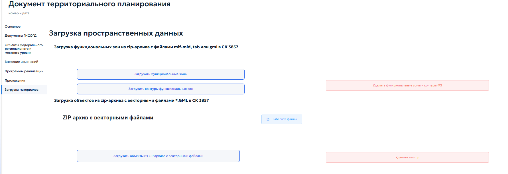
  <figcaption>Рисунок 72 — Блок «Загрузка пространственных материалов».</figcaption>
</figure>

При нажатии кнопки «Загрузить функциональные зоны» система открывает окно «Импорт» с кнопкой «Выбрать». При нажатии кнопки «Выбрать» открывается проводник операционной системы. После выбора архива система автоматически обрабатывает файлы и добавляет функциональные зоны в соответствующий реестр (рисунок 73). Данный функционал работает аналогично при нажатии других кнопок в блоке «Загрузка пространственных данных».

<figure class="doc-figure" markdown="span">
  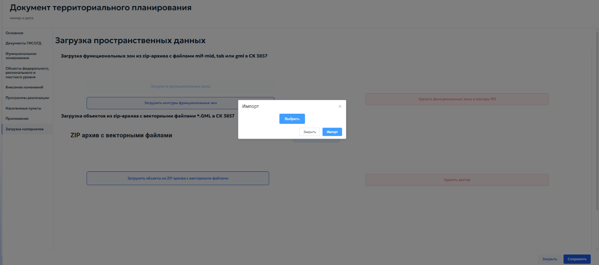
  <figcaption>Рисунок 73 — Окно «Импорт».</figcaption>
</figure>

Кнопка «Загрузить контуры функциональных зон» предназначена для импорта геометрии контуров функциональных зон из ZIP-архива с векторными файлами формата GML в системе координат EPSG:3857.

Кнопка «Загрузить объекты из ZIP-архива с векторными файлами» предназначена для импорта архива, содержащего векторные файлы формата GML.

Кнопка «Выберите файлы» — открывает стандартное окно операционной системы для выбора файлов на локальном компьютере.

Кнопка «Удалить вектор» — удаляет все загруженные ранее векторные данные текущего документа.
