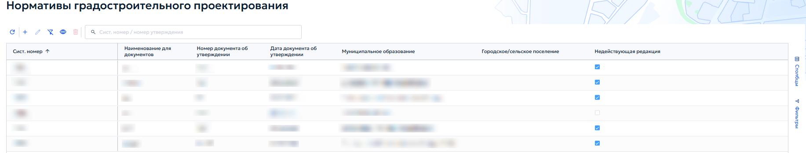
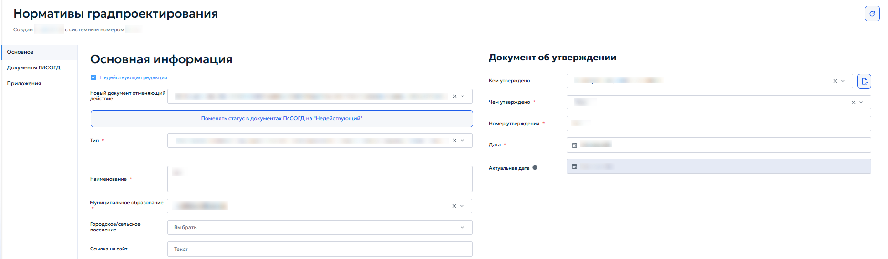

# 5.4.4 Нормативы градостроительного проектирования

Нормативы градостроительного проектирования устанавливают обязательные требования при строительстве и реконструкции объектов капитального строительства на территории муниципального образования. Они определяют расчётные параметры, которые необходимо учитывать при разработке документации по планировке территории: максимальные значения коэффициента плотности застройки, жилищную обеспеченность, размеры земельных участков для размещения многоквартирных жилых домов и т. п.

В раздел «Нормативы градостроительного проектирования» вносятся документы ГИСОГД — нормативы градостроительного проектирования и правовые акты об их утверждении или о внесении изменений. Для каждого муниципалитета в реестре создаётся одна запись, к которой прикрепляются соответствующие документы ГИСОГД.

Документы этого раздела не содержат картографических данных, поэтому в карточке записи отсутствует окно карты (рисунок 74).

<figure class="doc-figure" markdown="span">
  
  <figcaption>Рисунок 74 — Раздел 4. Реестр «Нормативы градостроительного проектирования».</figcaption>
</figure>

При добавлении или редактировании записи открывается карточка «Нормативы градпроектирования» (рисунок 75). В верхней части карточки отображаются дата создания и системный номер записи.

<figure class="doc-figure" markdown="span">
  
  <figcaption>Рисунок 75 — Карточка «Нормативы градпроектирования».</figcaption>
</figure>

Вкладка «Основное» содержит два информационных блока: «Основная информация» и «Документ об утверждении».

В состав блока «Основная информация» входят следующие информационные поля и флажки:

1. «Недействующая редакция» — если норматив утратил силу, здесь отображается ссылка на документ, которым он отменен. Кнопка «Поменять статус в документах ГИСОГД на „Недействующий“» позволяет перевести связанные документы ГИСОГД в статус недействующих;

2. «Тип» — выбрать тип норматива из выпадающего списка;

3. «Наименование» — ввести полное наименование норматива;

4. «Муниципальное образование» — выбрать муниципальное образование из списка;

5. «Городское/сельское поселение» — при необходимости выбрать поселение;

6. «Ссылка на сайт» — указать адрес страницы, где опубликован документ.

В состав блока «Документ об утверждении» входят следующие поля:

1. «Кем утверждено» — выбрать орган или должностное лицо, утвердившее норматив;

2. «Чем утверждено» — выбрать вид нормативного правового акта из выпадающего списка;

3. «Номер утверждения» — ввести номер документа;

4. «Дата» — указать дату утверждения с помощью календаря;

5. «Актуальная дата» — поле заполняется автоматически по дате документа ГИСОГД о внесении изменений.
