# 5.4.5 Градостроительное зонирование

В раздел «Градостроительное зонирование» вносятся правила землепользования и застройки территорий (далее — ПЗЗ), нормативные правовые акты об утверждении или внесении изменений в ПЗЗ, а также материалы публичных слушаний (рисунок 76). Для каждого муниципального образования в реестре создаётся одна запись, к которой прикрепляются документы ГИСОГД. В карточке записи ведётся реестр территориальных зон в соответствии с ПЗЗ.

<figure class="doc-figure" markdown="span">
  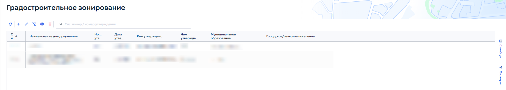
  <figcaption>Рисунок 76 — Раздел 5. Реестр «Градостроительное зонирование».</figcaption>
</figure>

При добавлении или редактировании записи открывается карточка «Градостроительное зонирование» (рисунок 77). Карточка содержит следующие вкладки: «Основное», «Документы ГИСОГД», «Территориальное зонирование», «Приложения».

<figure class="doc-figure" markdown="span">
  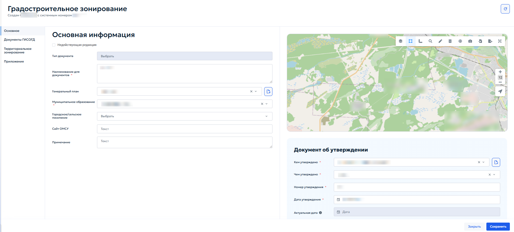
  <figcaption>Рисунок 77 — Карточка «Градостроительное зонирование».</figcaption>
</figure>

Порядок заполнения блоков «Основная информация» и «Документ об утверждении» аналогичен порядку создания записи, описанному в пункте [5.4.3.1 «Создание записи»](section-3.md#5431) настоящего Руководства.

В поле «Генеральный план» указать соответствующий генеральный план муниципального образования.

Во вкладке «Документы ГИСОГД» прикрепить файлы ПЗЗ и правовые акты об утверждении или внесении изменений. Порядок добавления документа ГИСОГД описан в пункте [5.4.3.3 «Добавление документов ГИСОГД»](section-3.md#5433).

## 5.4.5.1 Вкладка «Территориальное зонирование»

Вкладка предназначена для ведения списка территориальных зон, установленных ПЗЗ (рисунок 78).

<figure class="doc-figure" markdown="span">
  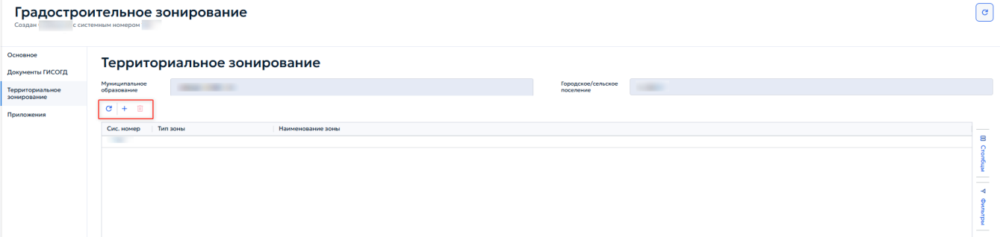
  <figcaption>Рисунок 78 — Территориальное зонирование.</figcaption>
</figure>

Добавление, редактирование и удаление зон выполняется с помощью кнопок панели инструментов. При создании или редактировании зоны открывается карточка «Территориальная зона» (рисунок 79).

<figure class="doc-figure" markdown="span">
  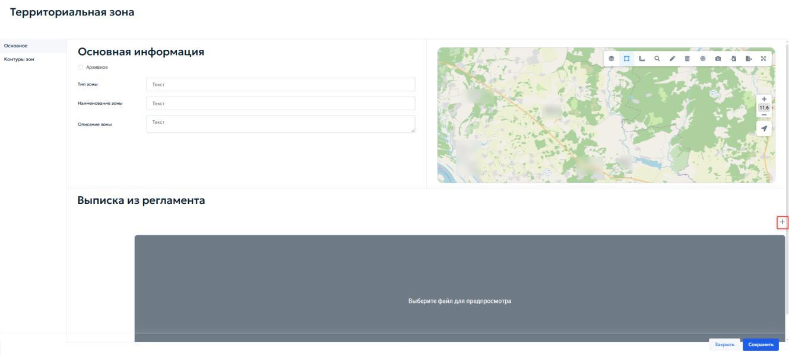
  <figcaption>Рисунок 79 — Территориальная зона.</figcaption>
</figure>

Во вкладке «Основное» в блоке «Основная информация» указываются следующие поля:

1. «Тип зоны» — ввести наименование типа территориальной зоны;

2. «Наименование зоны» — ввести наименование в соответствии с ПЗЗ;

3. «Описание зоны» — поле для текстового описания (при необходимости).

Если зона утратила актуальность и является архивной, установить флажок «Архивное» в начале блока.

В блоке «Выписка из регламента» для прикрепления файла с градостроительным регламентом нажать кнопку «Выберите файлы»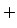{ .ui-icon }.

Вкладка «Градостроительные регламенты» предназначена для ведения перечня видов разрешённого использования (ВРИ) земельных участков и объектов капитального строительства в пределах территориальной зоны. Для каждого ВРИ указываются тип и наименование из справочника (рисунок 80).

<figure class="doc-figure" markdown="span">
  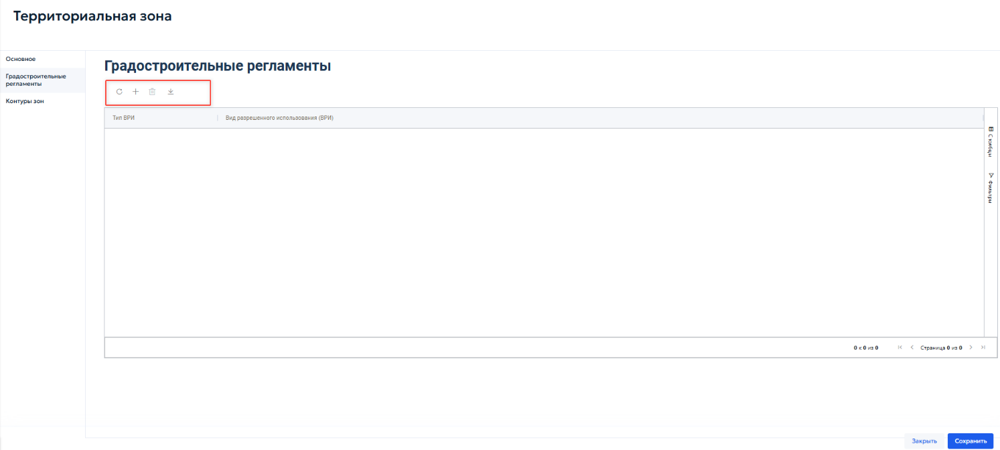
  <figcaption>Рисунок 80 — Градостроительные регламенты.</figcaption>
</figure>

Добавление, редактирование и удаление записей выполняются с помощью кнопок панели инструментов таблицы.

Для настройки параметров, установленных градостроительным регламентом для конкретного вида разрешенного использования, нажать кнопку «Добавить»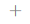{ .ui-icon }. Откроется карточка «Предельные величины» (рисунок 81).

<figure class="doc-figure" markdown="span">
  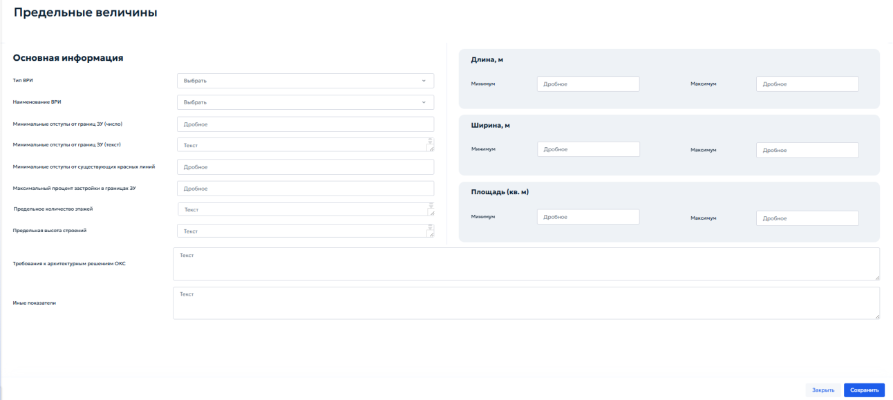
  <figcaption>Рисунок 81 — «Предельные величины».</figcaption>
</figure>

В блоке «Основная информация» указать следующие параметры:

1. «Тип ВРИ» — выбрать из выпадающего списка необходимый вариант;

2. «Наименование ВРИ» — выбрать вид разрешенного использования из справочника;

3. «Минимальные отступы от границ ЗУ (число)» — ввести числовое значение отступа в метрах;

4. «Минимальные отступы от границ ЗУ (текст)» — при необходимости указать текстовое описание отступов;

5. «Минимальные отступы от существующих красных линий» — ввести значение отступа в метрах (дробное число);

6. «Максимальный процент застройки в границах ЗУ» — указать максимально допустимый процент застройки земельного участка;

7. «Предельное количество этажей» — указать максимальное количество этажей (текст или число);

8. «Предельная высота строений» — указать максимальную высоту зданий (текст);

9. «Требования к архитектурным решениям ОКС» — ввести текстовые требования (при наличии);

10. «Иные показатели» — при необходимости указать дополнительные параметры.

В параметрах длины, ширины и площади указать:

1. «Длина, м» — указать дробное значение «Минимума» и «Максимума» необходимой длины объекта;

2. «Ширина, м» — указать дробное значение «Минимума» и «Максимума» необходимой ширины объекта;

3. «Площадь (кв. м)» — указать дробное значение «Минимума» и «Максимума» площади земельного участка или объекта капитального строительства в квадратных метрах.

После заполнения карточки и сохранения данных вернуться в реестр «Территориальная зона» и перейти во вкладку «Контуры зоны» (рисунок 82).

<figure class="doc-figure" markdown="span">
  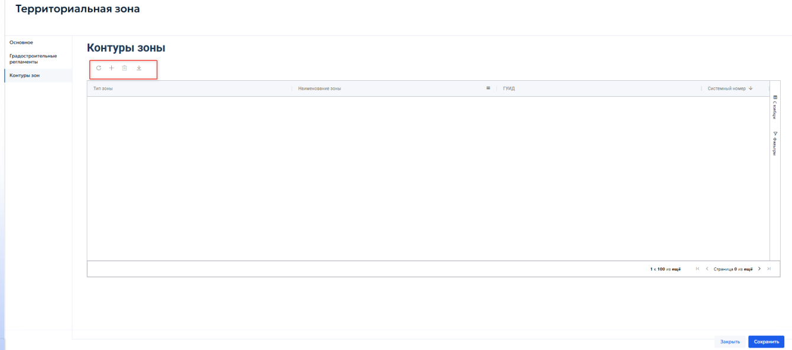
  <figcaption>Рисунок 82 — Вкладка «Контуры зоны».</figcaption>
</figure>

Вкладка предназначена для отображения и управления пространственными границами — контурами территориальной зоны. Контуры представляют собой полигоны, нанесенные на карту, и определяют местоположение зоны на местности.

Добавление, редактирование и удаление записей выполняются с помощью кнопок панели инструментов, расположенной над таблицей.

При нажатии кнопки «Добавить»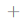{ .ui-icon } откроется карточка «Контуры зон» (рисунок 83).

<figure class="doc-figure" markdown="span">
  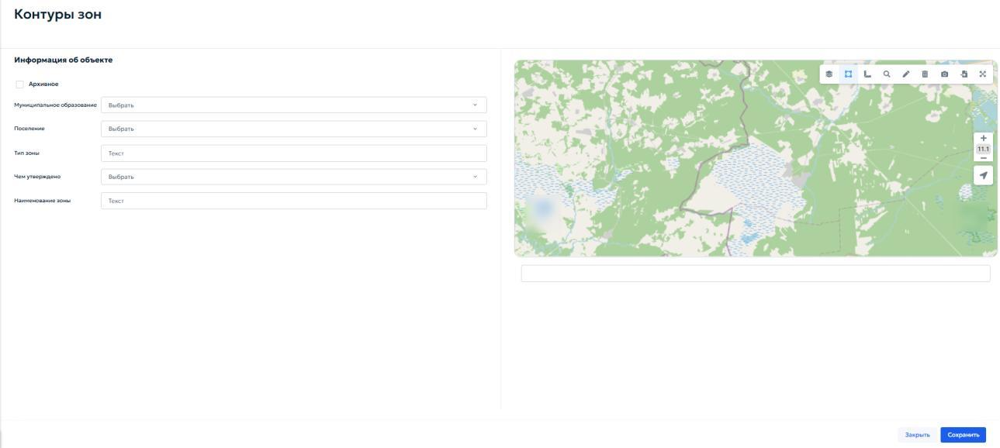
  <figcaption>Рисунок 83 — Карточка «Контуры зон».</figcaption>
</figure>

Карточка предназначена для указания параметров пространственного контура и загрузки его геометрии.

В блоке «Информация об объекте» заполнить следующие поля:

1. «Муниципальное образование» — выбрать из выпадающего списка муниципальное образование, на территории которого расположен контур;

2. «Поселение» — при необходимости выбрать городское или сельское поселение;

3. «Тип зоны» — отображается автоматически (наследуется из карточки территориальной зоны). Поле доступно только для просмотра;

4. «Чем утверждено» — выбрать из выпадающего списка документ ГИСОГД, которым утверждён данный контур (например, правовой акт об утверждении ПЗЗ или о внесении изменений);

5. «Наименование зоны» — отображается автоматически (наследуется из карточки территориальной зоны). Поле доступно только для просмотра.

Если контур является архивным, установить флажок «Архивное» в начале блока.
