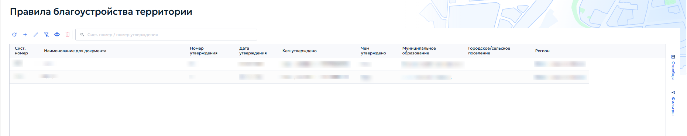
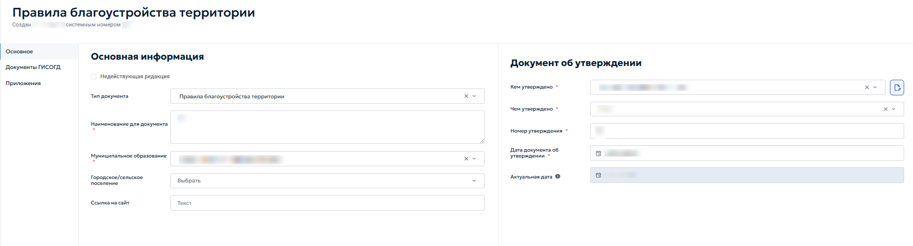

# 5.4.6 Правила благоустройства территории

В раздел «Правила благоустройства территории» вносятся документы, регулирующие вопросы благоустройства на муниципальном уровне. К таким документам относятся:

- правила благоустройства территории муниципального образования;

- нормативные правовые акты, которыми утверждены правила благоустройства территории или внесены изменения в них;

- закон субъекта Российской Федерации, которым утвержден порядок определения границ прилегающих территорий.

Раздел «Правила благоустройства территории» показан на рисунке 84.

<figure class="doc-figure" markdown="span">
  
  <figcaption>Рисунок 84 — Раздел 6. Реестр «Правила благоустройства территории».</figcaption>
</figure>

При добавлении или редактировании записи открывается одноименная с реестром карточка (рисунок 85).

<figure class="doc-figure" markdown="span">
  
  <figcaption>Рисунок 85 — Карточка «Правила благоустройства территории».</figcaption>
</figure>

Во вкладке «Основное» в блоке «Основная информация» указать следующие данные:

1. «Тип документа» — поле заполняется автоматически значением «Правила благоустройства территории»;

2. «Наименование для документа» — ввести полное наименование документа в соответствии с утвержденным актом;

3. «Муниципальное образование» — выбрать из выпадающего списка муниципальное образование, для которого разработаны правила;

4. «Городское/сельское поселение» — при необходимости выбрать поселение;

5. «Ссылка на сайт» — указать адрес страницы, где опубликован документ.

Если редакция является недействующей, установить флажок «Недействующая редакция» и выбрать в появившемся выпадающем списке необходимый вариант.

В блоке «Документ об утверждении» указать следующие данные:

1. «Кем утверждено» — выбрать орган или должностное лицо в выпадающем списке, утвердившее правила благоустройства;

2. «Чем утверждено» — выбрать вид нормативного правового акта из выпадающего списка;

3. «Номер утверждения» — ввести номер документа;

4. «Дата документа об утверждении» — указать дату утверждения с помощью календаря;

5. «Актуальная дата» — поле заполняется автоматически по дате последнего документа ГИСОГД о внесении изменений.
