# 5.4.7 Планировка территории

В раздел «Планировка территории» вносится документация по планировке территории, а также правовые акты о её утверждении или внесении изменений. Кроме того, здесь хранятся нормативные правовые акты, устанавливающие порядок подготовки, утверждения, изменения и отмены такой документации либо признания её отдельных частей недействующими.

Документация по планировке территории включает в себя проекты планировки и проекты межевания. Иногда эти два документа объединены в один — проект планировки и межевания одновременно.

Процесс разработки и утверждения проекта планировки и межевания состоит из нескольких этапов:

1. застройщик обращается в орган власти — муниципальный или региональный — за разрешением на подготовку проекта. Орган местного самоуправления уточняет границу, в пределах которой будет разрабатываться проект планировки, а также определяет границу участка для проведения инженерных изысканий. Формируется задание на проектирование, и издается постановление или приказ о подготовке проекта планировки и межевания. В этом документе указываются предельные сроки разработки проекта и срок его предоставления на утверждение;

2. застройщик поручает проектировщику разработку проекта планировки. Проектировщик проводит необходимые инженерные изыскания и готовит проект;

3. застройщик передает готовый проект в тот орган власти, который выдал задание на проектирование. В ГИСОГД вносится запись о новой версии проекта, которая привязывается к ранее созданной записи на проектирование;

4. специалисты рассматривают проект, формируют замечания и возвращают его на доработку. Все замечания прикрепляются к версии проекта в ГИСОГД. Процесс повторяется до устранения всех замечаний;

5. после устранения всех замечаний документация по планировке территории утверждается правовым актом. Утвержденный проект заносится в реестр как документ ГИСОГД.

Материалы инженерных изысканий, выполненных при разработке проекта планировки и межевания, вносятся в раздел [5.4.8 — Инженерные изыскания](section-8.md#548) «Инженерные изыскания».

Для выдачи задания на проектирование в реестре «Планировка территории» необходимо создать новую запись о проекте в таблице, нажав кнопку «Добавить»{ .ui-icon } (рисунок 86). Работа с реестром выполняется в соответствии с общими принципами, описанными в разделе [4.2 — Работа с табличными формами](../../operations/navigation-and-tables.md#42) настоящего Руководства.

<figure class="doc-figure" markdown="span">
  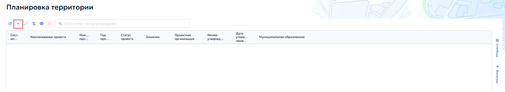
  <figcaption>Рисунок 86 — Раздел 7. Реестр «Планировка территории».</figcaption>
</figure>

При добавлении или редактировании записи открывается карточка «Проект планировки и межевания территории» (рисунок 87).

<figure class="doc-figure" markdown="span">
  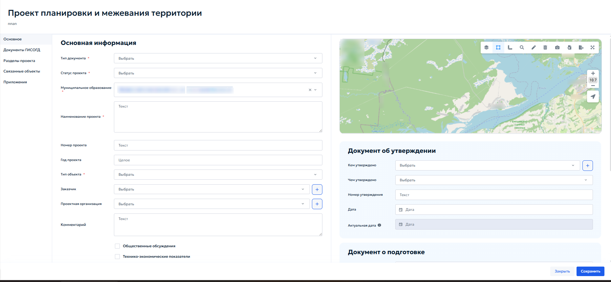
  <figcaption>Рисунок 87 — Карточка «Проект планировки и межевания территории».</figcaption>
</figure>

Во вкладке «Основное» в блоке «Основная информация» указать следующие данные:

1. «Тип документа» — выбрать тип документа из выпадающего списка;

2. «Статус проекта» — выбрать текущий статус из выпадающего списка:

    1.  при выборе статуса «Аннулировано» в карточке появляется поле «Основания для отмены» — выпадающий список, содержащий ссылки на документы ГИСОГД, на основании которых проект аннулируется. Выбрать нужный документ из списка (рисунок 88);

        <figure class="doc-figure" markdown="span">
          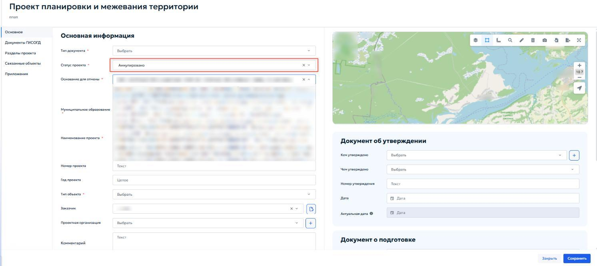
          <figcaption>Рисунок 88 — Статус «Аннулировано» с выбором документа-основания для отмены.</figcaption>
        </figure>

    2.  при выборе статуса «Аннулировано» появляется кнопка «Поменять статус в документах ГИСОГД на „Недействующий“» (рисунок 89). После нажатия все связанные с проектом документы ГИСОГД перейдут в статус недействующих.

        <figure class="doc-figure" markdown="span">
          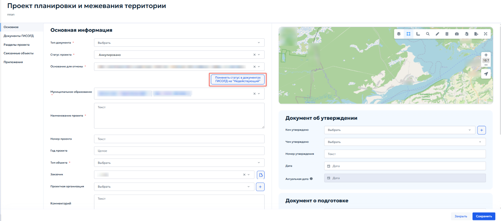
          <figcaption>Рисунок 89 — Кнопка «Поменять статус в документах ГИСОГД».</figcaption>
        </figure>

3. «Муниципальное образование» — выбрать муниципальное образование, на территории которого планируется разработка проекта;

4. «Наименование проекта» — ввести полное наименование проекта в соответствии с документацией;

5. «Номер проекта» — указать присвоенный органом власти учетный номер проекта;

6. «Год проекта» — указать год разработки или утверждения проекта;

7. «Тип объекта» — выбрать тип объекта из справочника;

8. «Заказчик» — выбрать организацию-заказчика из справочника;

9. «Проектная организация» — выбрать организацию-разработчика проекта из справочника;

10. «Комментарии» — при необходимости ввести текстовые примечания.

При установке флажка «Общественные обсуждения» в левой навигационной панели карточки появляется дополнительная одноименная вкладка.

Заполнение блока «Документ об утверждении» выполняется в порядке, описанном в пункте [5.4.3.2 — Заполнение вкладки «Основное»](section-3.md#5432).

В блоке «Документ о подготовке» содержатся сведения о разрешении на подготовку проекта.

Указать следующие данные о разрешении на подготовку проекта:

1. «Номер заявки» — указать регистрационный номер обращения застройщика;

2. «Дата заявки» — указать дату подачи заявки;

3. «Кем утверждено» — указать орган, выдавший разрешение на подготовку;

4. «Чем утверждено» — выбрать вид акта;

5. «Номер утверждения» — указать номер акта;

6. «Дата утверждения» — указать дату выдачи разрешения;

7. «Номер градзадания» — номер градостроительного задания на проектирование;

8. «Срок разработки» — плановая дата завершения разработки проекта;

9. «Дата выдачи ИРД» — при наличии указать дату выдачи исходно-разрешительной документации.

## 5.4.7.1 Вкладка «Общественные обсуждения»

Вкладка «Общественные обсуждения» в карточке «Проект планировки и межевания территории» (рисунок 90) предназначена для учёта сведений об общественных обсуждениях, проведённых по проекту планировки и межевания территории.

<figure class="doc-figure" markdown="span">
  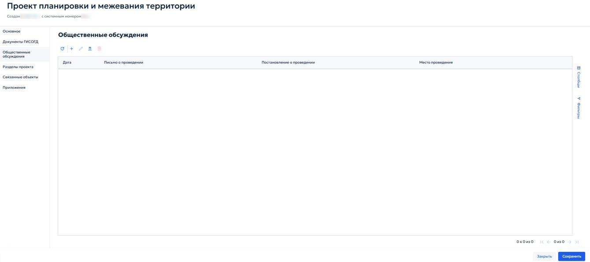
  <figcaption>Рисунок 90 — Вкладка «Общественные обсуждения».</figcaption>
</figure>

Для добавления записи об общественных обсуждениях нажать кнопку «Добавить» { .ui-icon } на панели инструментов вкладки. Откроется карточка (рисунок 91), в которой необходимо указать следующие данные:

<figure class="doc-figure" markdown="span">
  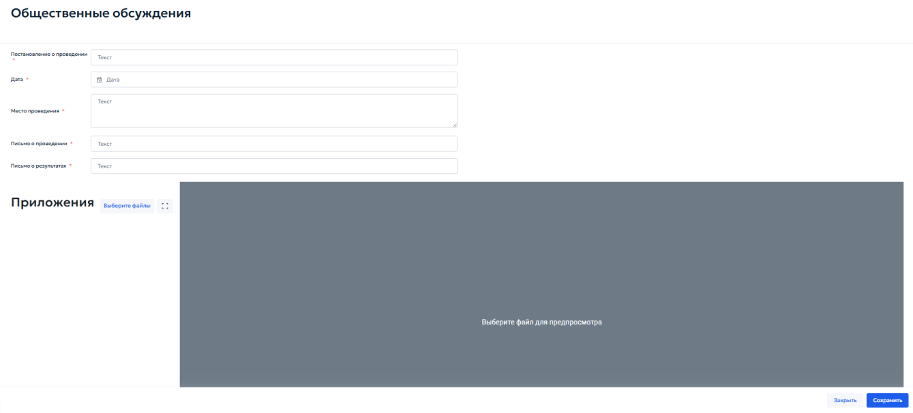
  <figcaption>Рисунок 91 — Карточка «Общественные обсуждения».</figcaption>
</figure>

1. «Постановление о проведении» — указать реквизиты правового акта, которым назначены общественные обсуждения;

2. «Дата» — выбрать дату проведения обсуждений с помощью календаря;

3. «Место проведения» — ввести адрес или наименование места, где проводились обсуждения;

4. «Письмо о проведении» — указать реквизиты исходящего письма, направленного для организации обсуждений;

5. «Письмо о результатах» — указать реквизиты документа, фиксирующего итоги обсуждений.

## 5.4.7.2 Вкладка «Разделы проекта»

Вкладка «Разделы проекта» (рисунок 92) предназначена для создания и управления структурой цифровой модели проекта планировки и межевания территории. Здесь определяются смысловые разделы проекта, загружаются векторные данные и проверяются пересечения земельных участков с кадастровым планом территории.

<figure class="doc-figure" markdown="span">
  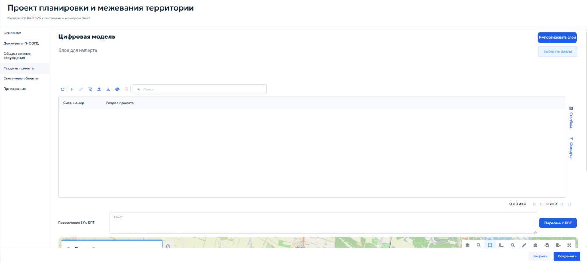
  <figcaption>Рисунок 92 — Вкладка «Разделы проекта».</figcaption>
</figure>

В верхней части вкладки расположен блок «Цифровая модель» для загрузки векторных данных.

Кнопка «Выберите файлы» открывает проводник операционной системы. Импорт поддерживается из векторных форматов файлов, которые должны быть упакованы в ZIP-архив.

После выбора необходимого архива система выполнит аналитику содержимого и отобразит список доступных векторных слоев. Для импорта выполнить следующие действия:

1. в списке отметить флажками слои, которые необходимо загрузить в проект (рисунок 93);

    <figure class="doc-figure" markdown="span">
      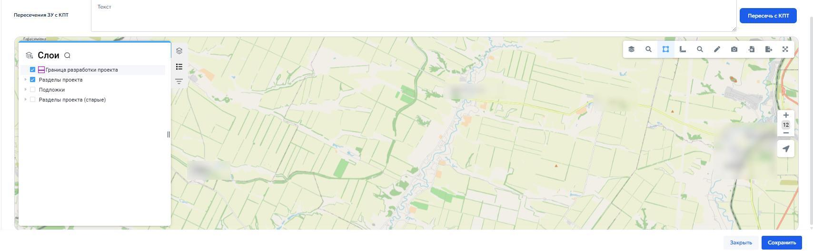
      <figcaption>Рисунок 93 — Слои проекта.</figcaption>
    </figure>

2. нажать кнопку «Импортировать слои» — система выгрузит выбранные слои и автоматически распределит их по соответствующим разделам проекта.

Если после импорта требуется добавить дополнительные данные, повторить процедуру, отметить новые слои и нажать кнопку «Импортировать слои». Загруженные ранее слои не удаляются.

Таблица разделов проекта содержит все добавленные разделы. Для каждого раздела указываются системный номер записи и тип раздела (рисунок 94).

<figure class="doc-figure" markdown="span">
  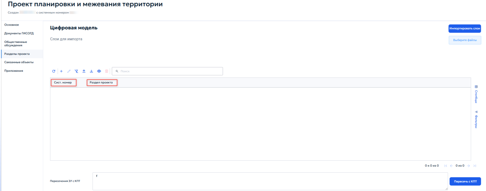
  <figcaption>Рисунок 94 — Таблица разделов проекта.</figcaption>
</figure>

При добавлении или редактировании записи раздела открывается окно «Выберите раздел проекта» с выпадающим списком (рисунок 95).

<figure class="doc-figure" markdown="span">
  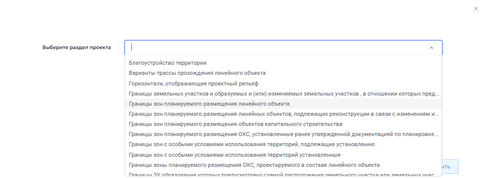
  <figcaption>Рисунок 95 — Окно выбора раздела проекта.</figcaption>
</figure>

После выбора типа раздела и нажатия кнопки «Далее» открывается карточка «Раздел проекта» (рисунок 96).

<figure class="doc-figure" markdown="span">
  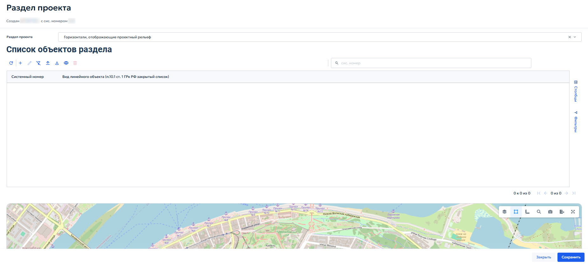
  <figcaption>Рисунок 96 — Карточка «Раздел проекта».</figcaption>
</figure>

В блоке «Список объектов раздела» представлена таблица, содержащая перечень всех пространственных объектов, входящих в данный раздел. В таблице указывается системный номер записи и вид линейного объекта в соответствии с Градостроительным кодексом РФ.

При нажатии кнопки «Добавить»{ .ui-icon } откроется карточка «Горизонтали, отображающие проектный рельеф» (рисунок 97).

<figure class="doc-figure" markdown="span">
  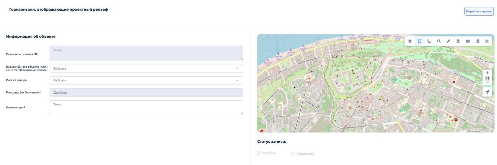
  <figcaption>Рисунок 97 — Карточка «Объект раздела».</figcaption>
</figure>

Карточка предназначена для загрузки геометрии конкретного объекта и заполнения его атрибутов.

В блоке «Информация об объекте» указать следующие данные:

1. «Реквизиты проекта» — указать реквизиты документации, на основании которой создается объект;

2. «Примечание» — при необходимости ввести дополнительные сведения об объекте.

В статусе записи указать необходимый флажок:

1. «История» — установить флажок, если объект относится к архивным;

2. «Утверждено» — установить флажок, если объект утвержден в составе документации по планировке территории.

При нажатии кнопки «Перейти в проект» система закрывает карточку объекта раздела и открывает карточку родительского проекта планировки и межевания территории.

## 5.4.7.3 Вкладка «Связанные объекты»

Вкладка «Связанные объекты» в карточке «Проект планировки и межевания территории» предназначена для установления и визуализации логических связей между документацией по планировке территории и смежными объектами учета, размещенными в других разделах ГИСОГД.

1. «Дела о земельных участках» (Дела о ЗУ) — отображение земельных участков, входящих в границы проекта планировки;

2. «Инженерные изыскания» — отображение материалов изысканий, выполненных для данной территории;

3. «Надземные и подземные коммуникации» — отображение существующих и проектируемых сетей;

4. «Зоны с особыми условиями использования территории» (ЗОУИТ) — отображение зон с особыми условиями использования территории.

Для каждого из перечисленных подразделов интерфейс предоставляет стандартные элементы управления табличными формами, позволяющие как создавать новые объекты, так и устанавливать ссылки на уже существующие записи в соответствующих реестрах.

Детальное описание состава атрибутов, порядка заполнения карточек и правил работы с объектами приведено в соответствующих разделах настоящего Руководства:

1. порядок работы с «Делами о ЗУ», включая формирование ГПЗУ, разрешений на строительство, СРЗУ и ведение истории участка, приведен в разделе [5.4.13 — Дела о застроенных или подлежащих застройке земельных участках](section-13/index.md#5413);

2. порядок работы с «Инженерными изысканиями» приведен в разделе [5.4.8 — Инженерные изыскания](section-8.md#548);

3. порядок работы с «Надземными и подземными коммуникациями» — см. раздел [5.4.11 — Надземные и подземные коммуникации](section-11.md#5411);

4. порядок работы с ЗОУИТ приведен в разделе [5.4.10 — ЗОУИТ](section-10.md#5410) настоящего Руководства.

Операции по установлению связей через кнопку «Связать» выполняются по общим правилам работы со связанными реестрами, описанными в пункте [4.3 — Управление записями в реестре](../../operations/records.md#43) настоящего Руководства.
