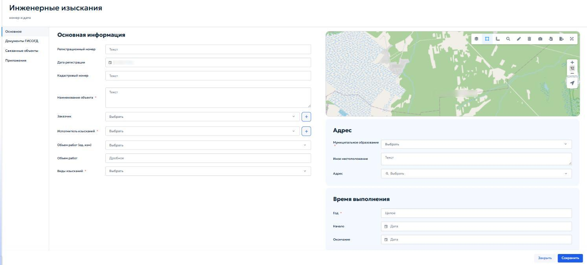
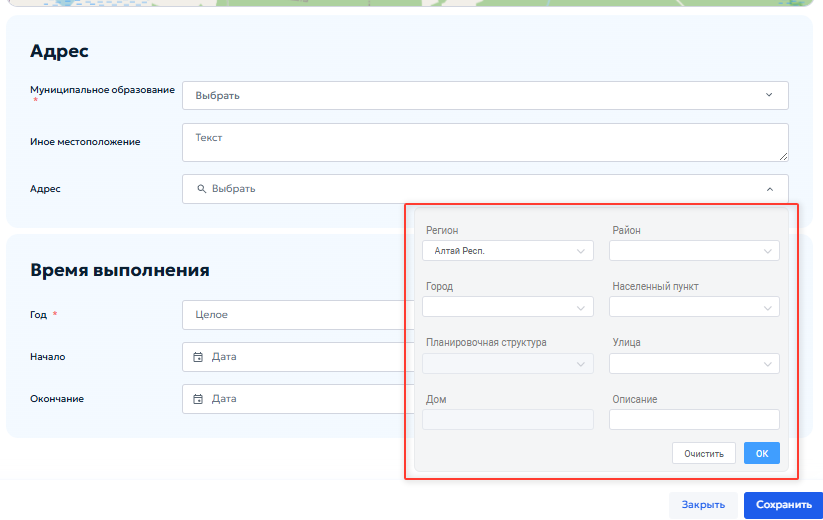

# 5.4.8 Инженерные изыскания

Раздел «Инженерные изыскания» предназначен для сбора, учета, хранения и систематизации сведений о материалах и результатах инженерных изысканий, выполненных на территории региона. Ведение раздела осуществляется в соответствии с пунктом 10 части 4 статьи 56 Градостроительного кодекса Российской Федерации и постановлением Правительства Российской Федерации от 13.03.2020 № 279 «Об информационном обеспечении градостроительной деятельности».

В реестр включаются сведения о следующих видах работ:

1. инженерные изыскания для подготовки проектной документации объектов капитального строительства;

2. инженерные изыскания для подготовки документации по планировке территории;

3. исполнительная съемка, выполняемая в процессе строительства, реконструкции объектов капитального строительства, а также по их окончании;

4. инвентаризация существующих инженерных сетей и сооружений, выполняемая для целей кадастрового учета и установления границ зон с особыми условиями использования территории.

Реестр обеспечивает возможность установления связей между записью об инженерных изысканиях и объектами других разделов ГИСОГД:

1. с проектом планировки и межевания территории — если изыскания выполнялись в рамках разработки документации по планировке территории;

2. с делом о застроенном или подлежащем застройке земельном участке — если изыскания выполнялись в отношении конкретного земельного участка.

При открытии раздела «Инженерные изыскания» отображается табличная форма, содержащая перечень записей реестра. Работа с реестром осуществляется в соответствии с общими принципами, описанными в разделе [4.2 «Работа с табличными формами»](../../operations/navigation-and-tables.md#42) настоящего Руководства.

Добавление новой записи или редактирование существующей выполняется в карточке «Инженерные изыскания». Карточка содержит вкладки «Основное», «Документы ГИСОГД» и «Приложения» (рисунок 98).

<figure class="doc-figure" markdown="span">
  
  <figcaption>Рисунок 98 — Карточка «Инженерные изыскания».</figcaption>
</figure>

Вкладка «Основное» в карточке предназначена для ввода характеристик выполненных инженерных изысканий.

В блоке «Основная информация» указать следующие данные:

1. «Регистрационный номер» — ввести учетный номер материалов изысканий;

2. «Дата регистрации» — в поле автоматически указывается текущая дата при сохранении записи;

3. «Кадастровый номер» — указать номер земельного участка;

4. «Наименование объекта» — ввести имя объекта, в отношении которого выполнены изыскания;

5. «Заказчик» — выбрать из выпадающего списка необходимую организацию. Кнопка { .ui-icon } позволяет добавить новую организацию в справочник;

6. «Исполнитель изысканий» — выбрать из выпадающего списка исполнителя, который будет выполнять изыскания по земельному участку. Кнопка { .ui-icon } позволяет добавить новую организацию в справочник;

7. «Объем работ (ед. изм.)» — выбрать единицы измерения объема выполненных работ из выпадающего списка;

8. «Виды изысканий» — выбрать одно или несколько значений из выпадающего списка видов изысканий.

## Выбор адреса { #address-selection }

В блоке «Адрес» указать следующие сведения о местоположении участка выполнения работ:

1. «Муниципальное образование» — выбрать городской округ или муниципальный район, к которому относятся инженерные изыскания;

2. «Иное местоположение» — указать дополнительные сведения о местоположении объекта, если они отличаются от текущего местоположения;

3. «Адрес» — указать местоположение объекта. Для корректного заполнения нажать кнопку «Выбрать». Откроется окно для заполнения элементов адреса (рисунок 99).

<figure class="doc-figure" markdown="span">
  
  <figcaption>Рисунок 99 — Окно выбора адреса.</figcaption>
</figure>

В блоке «Время выполнения» указываются:

1. «Год» — год завершения работ (указывается целым числом);

2. «Начало» — дата начала выполнения работ;

3. «Окончание» — дата завершения работ.

Во вкладках «Документы ГИСОГД», «Приложения» и «Связанные объекты» выполняются действия, описанные в пунктах [5.2.3 «Приложения»](../requests.md#523), [5.3.2 «Размещение документа во вкладке «Документы ГИСОГД»](../document-placement.md#532), [5.3.3 «Связывание документа ГИСОГД с заявкой на размещение»](../document-placement.md#533) и [5.4.7.3 «Связанные объекты»](section-7.md#5473).
