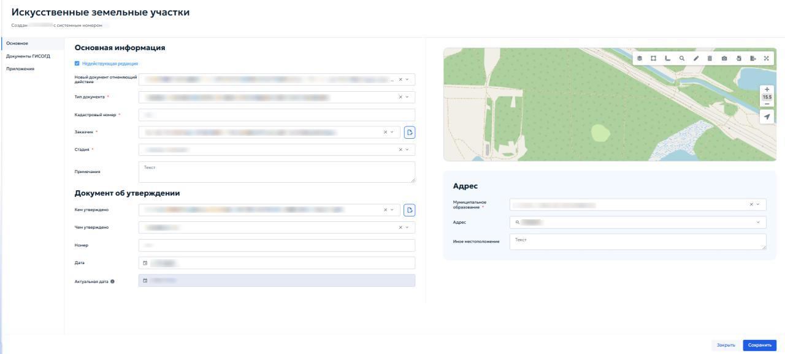
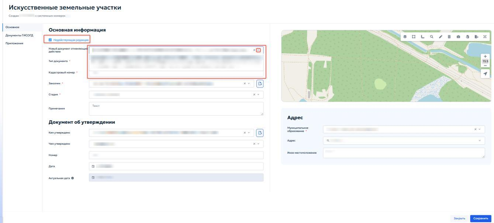

# 5.4.9 Искусственные земельные участки

Раздел «Искусственные земельные участки» предназначен для ведения реестра сведений, документов и материалов в отношении искусственных земельных участков, созданных на водных объектах или иных территориях в соответствии с законодательством Российской Федерации. Ведение раздела осуществляется в соответствии с пунктом 11 части 4 статьи 56 Градостроительного кодекса Российской Федерации и постановлением Правительства Российской Федерации от 13.03.2020 № 279.

В реестр включаются следующие типы документов:

1. разрешение на создание искусственного земельного участка;

2. разрешение на проведение работ по созданию искусственного земельного участка;

3. разрешение на ввод искусственно созданного земельного участка в эксплуатацию.

Для каждого искусственного земельного участка в реестре создается отдельная запись, к которой прикрепляются соответствующие документы ГИСОГД. На карте отображаются границы искусственного земельного участка.

При открытии раздела отображается табличная форма со списком записей. Работа с реестром выполняется в соответствии с общими принципами, описанными в разделе [4.2 «Работа с табличными формами»](../../operations/navigation-and-tables.md#42) настоящего Руководства.

Добавление и редактирование записей выполняются в карточке «Искусственный земельный участок». Карточка содержит вкладки «Основное», «Документы ГИСОГД» и «Приложения» (рисунок 100).

<figure class="doc-figure" markdown="span">
  
  <figcaption>Рисунок 100 — Карточка «Искусственный земельный участок».</figcaption>
</figure>

Вкладка «Основное» предназначена для ввода основных сведений об искусственном земельном участке и документе, на основании которого внесены данные.

В блоке «Основная информация» указать следующие данные:

1. «Недействующая редакция» — установить флажок, если запись или документ утратили силу. После установки флажка отображается поле «Новый документ, отменяющий действие» (рисунок 101). Выбрать в нём соответствующий документ ГИСОГД;

    <figure class="doc-figure" markdown="span">
      
      <figcaption>Рисунок 101 — Флажок «Недействующая редакция» и поле «Новый документ, отменяющий действие».</figcaption>
    </figure>

2. «Тип документа» — выбрать из выпадающего списка тип документа ГИСОГД;

3. «Кадастровый номер» — ввести кадастровый номер искусственного земельного участка;

4. «Заказчик» — выбрать из выпадающего списка организацию или физическое лицо, выполняющее роль заказчика. Кнопка { .ui-icon } позволяет добавить новую запись в справочник;

5. «Стадия» — выбрать из выпадающего списка текущую стадию участка;

6. «Примечания» — при необходимости ввести примечание по объекту.

В блоке «Документ об утверждении» указать следующие данные:

1. «Кем утверждено» — выбрать орган или лицо, утвердившее документ;

2. «Чем утверждено» — выбрать вид документа, которым утверждено создание искусственного земельного участка;

3. «Номер» — указать номер документа об утверждении;

4. «Дата» — указать дату документа об утверждении;

5. «Актуальная дата» — поле заполняется автоматически при внесении изменений документом ГИСОГД.

В блоке «Адрес» указать следующие данные:

1. «Муниципальное образование» — выбрать из списка нужный городской округ или муниципальный район;

2. «Адрес» — указать местоположение объекта. Нажать кнопку «Выбрать» и заполнить адрес в открывшемся окне по таким же принципам, как указано в пункте [5.4.8 «Выбор адреса»](section-8.md#address-selection) настоящего Руководства;

3. «Иное местоположение» — указать дополнительные сведения о местоположении объекта, если они отличаются от выбранного адреса.

На вкладках «Документы ГИСОГД» и «Приложения» выполняются действия, описываемые в пунктах [5.2.3 «Приложения»](../requests.md#523) и [5.3.2 «Размещение документа во вкладке «Документы ГИСОГД»](../document-placement.md#532) настоящего Руководства.
