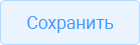
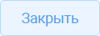

# Условные обозначения и кнопки { .gisogd-reference-title }

Обозначения помогают определить, какие данные нужно заполнить и какое действие выполняет кнопка. Набор доступных кнопок зависит от открытого реестра или карточки.

## Обозначения полей

| Обозначение | Значение |
| --- | --- |
| \* рядом с полем | Поле обязательно для заполнения |
| Серый цвет поля | Поле недоступно для редактирования |
| { .ui-icon } | Очистка значения поля. При множественном выборе кнопка рядом со значением удаляет только его, а кнопка в правой части поля — все выбранные значения |
| { .ui-icon } | Открытие списка значений из связанной таблицы. Для поиска можно ввести часть текста в поле |

Типы полей и порядок их заполнения описаны в разделе [4.5 — Работа с карточкой записи](../operations/records.md#45).

## Кнопки реестра и карточки

| Кнопка | Действие |
| --- | --- |
| { .ui-icon } | Обновить отображение реестра |
| { .ui-icon } | Добавить новую запись |
| { .ui-icon } | Редактировать запись |
| { .ui-icon } | Удалить одну или несколько записей, предварительно выделенных маркерами |
| { .ui-icon } | Открыть реестр и выбрать существующую запись для связи с текущим объектом |
| { .ui-icon } | Разорвать связь с записью. Перед нажатием выделить её в списке связанных объектов |
| { .ui-icon } | Сохранить внесённые данные или изменения карточки |
| { .ui-icon } | Выйти из карточки без сохранения внесённых данных или изменений |

**Разрыв связи не следует путать с удалением записи из реестра.** Для этих действий предусмотрены разные кнопки.

Порядок управления записями приведён в разделе [4.3 — Управление записями в реестре](../operations/records.md#43). Работа со связанными записями показана в разделе [4.5 — Работа с карточкой записи](../operations/records.md#45).
